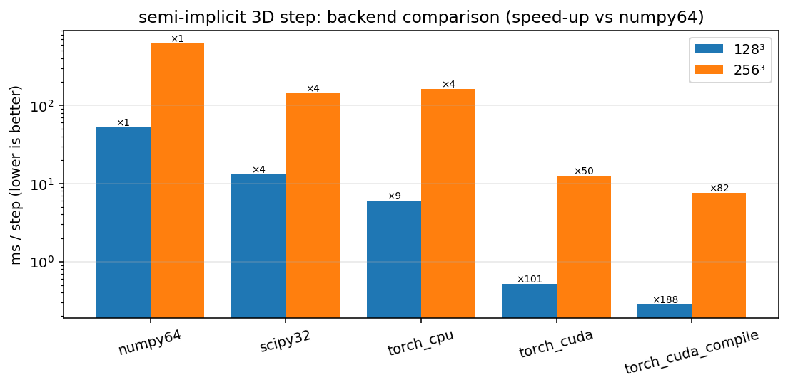
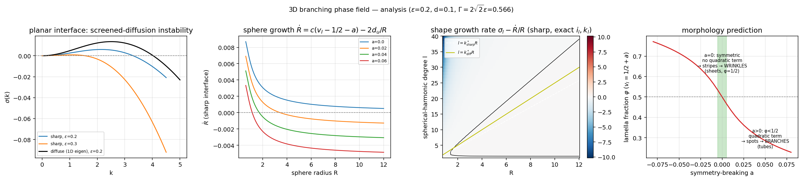
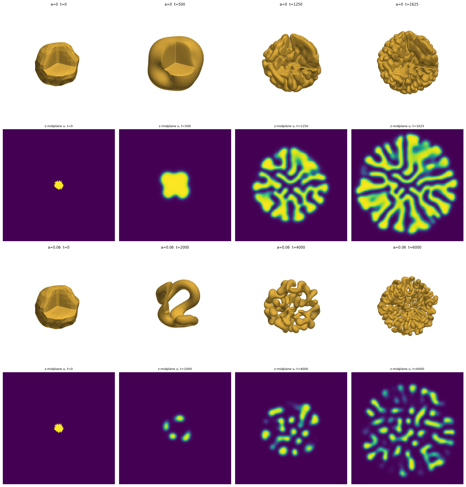
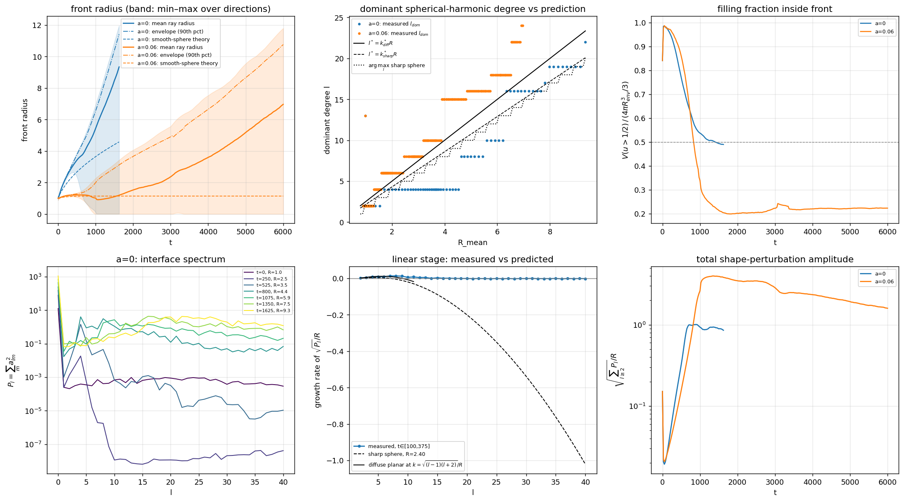
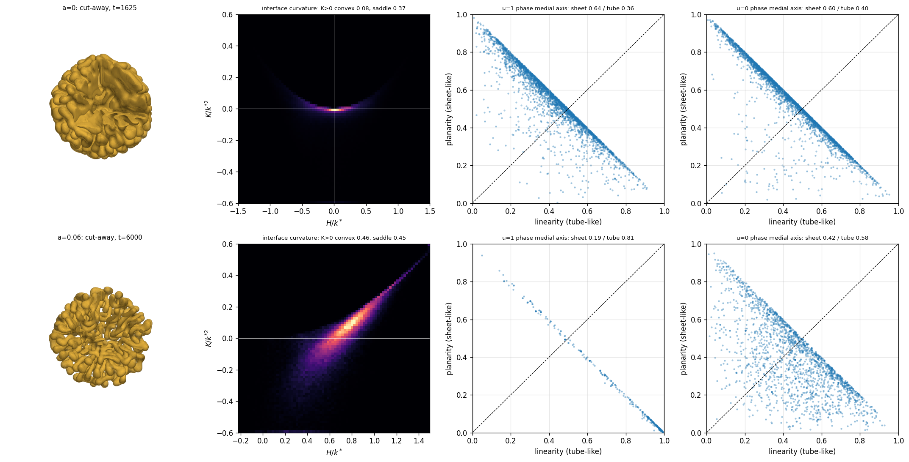
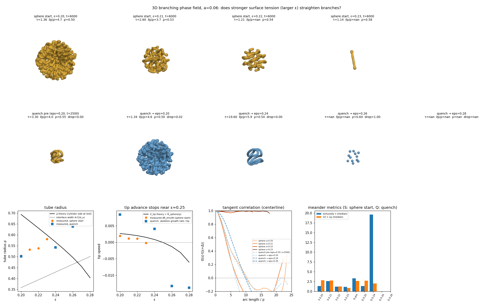

# phase_field_branching_3d — 3D 分枝フェーズフィールド（球＋摂動からの成長）

対応スクリプト: [`phase_field_branching_3d.py`](phase_field_branching_3d.py)（2D 版: [`phase_field_branching.md`](phase_field_branching.md)）。

## モデル

2D 版と同じ 2 場系を 3D 周期箱で解く。対称性を破る制御パラメータ $a$ を追加（$a=0$ が元モデル）。

$$
u_t = d_u\Delta u + u(1-u)(u+v-1-a),\qquad v_t = d\,\Delta v + 1-u-v,\qquad d_u=\varepsilon^2 d .
$$

既定値: $\varepsilon=0.2,\ d=0.1,\ \Delta t=0.5,\ \Delta x=0.1,\ n=256^3\ (L=25.6)$。
初期条件: 半径 $R_0=1$ の球に、点ごとに一様乱数 $\pm1$ 格子の半径摂動（2D 版と同じ作り方）、$v=0$。

## 数値スキーム（半陰解法）

2D 版と同じく、反応項は陽的、拡散項はスペクトル陰的に扱う。

$$
\hat u^{n+1} = \frac{\widehat{u^n+\Delta t\,f(u^n,v^n)}}{1+\Delta t\,d_u\lambda_h(\mathbf k)},\qquad
\lambda_h=\sum_{i=1}^3\frac{2-2\cos k_i\Delta x}{\Delta x^2}
$$

（7 点ラプラシアンの記号。.nb の `1/Fourier[kernel]` と同値で、numpy の kernel-FFT 版との差は 20 ステップで $\max|\Delta u|=8.9\times10^{-7}$。）

### 高速化（1 ステップあたり）

| backend | 128³ | 256³ |
|---|---|---|
| numpy float64（2D 版と同じ書き方） | 52.5 ms | 619 ms |
| scipy.fft float32, workers, u・v バッチ | 13.0 ms | 142 ms |
| torch CPU float32 | 6.0 ms | 163 ms |
| torch CUDA float32 | 0.52 ms | 12.4 ms |
| torch CUDA + `torch.compile` | 0.28 ms | **7.6 ms** |

256³ では numpy 比で約 80 倍。本計算（診断込み）は 14 ms/step で、$a=0$ の 3250 ステップに 46 秒、$a=0.06$ の 12000 ステップに 169 秒かかった。



## 数理解析（予測）



**シャープ界面極限。** $u$ の界面は進行波解 $u=\tfrac12(1+\tanh(\xi/2\sqrt{2d_u}))$ で、速度は $c=\sqrt{2d_u}$。
法線速度は

$$
V_n = c\,(v_I-\tfrac12-a) - d_u H,
$$

$v$ は遮蔽拡散長 $\ell=\sqrt d$ をもつ遮蔽 Poisson 方程式 $\ell^2\Delta v = v-\mathbb 1_{u=0}$ に従う。

1. **平面界面**:
   $\sigma(k)=\dfrac{c}{2\ell}\Bigl(1-\dfrac1{\sqrt{1+k^2\ell^2}}\Bigr)-d_u k^2$。
   長波長で不安定になる条件は $\Gamma=2\sqrt2\,\varepsilon<1$ で、既定値では $\Gamma=0.566$ となり**不安定**。
   最大成長波数は $k^*_{\rm sharp}=2.15$（$\lambda=2.92$）。
   1D 定常界面の線形化固有値（拡散界面）では $k^*=2.5$（$\lambda=2.51$）、$\sigma_{\max}=0.0135$。
   界面幅と $\ell$ の比 $\sqrt2\varepsilon$ が小さくないため、拡散界面の方がやや不安定になる。
2. **球**: 修正球 Bessel 関数 $i_l,k_l$ を用いると、$v_I=s/(p+s)$（$p=i_0'/i_0,\ s=-k_0'/k_0$ を $R/\ell$ で評価）。
   $\dot R=c(v_I-\tfrac12-a)-2d_u/R$ で、$a=0$ では $\dot R(R_0{=}1)=0.0060$ と膨張する。
   球面調和モード $l$ の成長率は
   $\sigma_l = c\,[p\,v_I/\ell - 1/(\ell W_l)] - d_u(l-1)(l+2)/R^2$
   （$W_l=i_l'/i_l-k_l'/k_l$、並進モードについて $\sigma_1=0$ が厳密に成り立つ）。
   支配的な次数は $l^*\approx k^*R$ に従って増えていくので、表面は「次々と新しい凹凸を生む」成長になる。
3. **枝か皺か（非線形の選択）**: $a=0$ では $(u,v)\to(1-u,1-v)$ の対称性があり、振幅方程式に 2 次項が現れない。
   そのためストライプ（3D ではラメラ＝**皺・膜**）が選択され、体積分率は $\varphi\to1/2$ になる。
   $a\ne0$ では 2 次項が生じて**スポット／チューブ（枝）**が選ばれる。
   ラメラの界面条件 $v_I=\tfrac12+a$ から、$\varphi(a{=}0.06)=0.264$ と予測される。

**予測:** $a=0$ では球が膨張しながら $\lambda\approx2.5$–$2.9$ の**皺（膜状ラメラ）**が伸び、$\varphi\approx0.5$ になる。$a=0.06$ では球はほぼ膨張せず、先端から**枝（チューブ）**が伸び、$\varphi\approx0.26$ になる。

## 結果（256³）







| 指標 | $a=0$ | $a=0.06$ |
|---|---|---|
| 平均前線半径（終状態） | 9.3（t=1625 で境界に到達し停止） | 7.0（t=6000） |
| 殻内の $u{=}1$ 体積分率 $\varphi$（予測） | **0.505**（0.5） | **0.215**（0.264） |
| 界面の平均曲率 $H/k^*$ の中央値 | −0.04（ほぼ極小曲面的） | +0.68（凸） |
| 鞍点面 $K<0$ / 凸面 $K>0$ の割合 | 0.37 / 0.08 | 0.45 / 0.46 |
| $u{=}1$ 相の中軸: 膜 / 管 | **0.64 / 0.36** | **0.19 / 0.81** |

- **$a=0$: 皺（ラメラ）。** 初期の凹凸は $l$ の低いモードから成長し（$t=500$ で 4 葉形）、その後、膜状の $u=1$ 層と $u=0$ 層が交互に積み重なる迷路状の皺になった。両相とも中軸は膜が優勢で（0.64 と 0.60）、$H\approx0$ で鞍点面が多い点も、厚さ一定の曲がったラメラであることを示している。$\varphi=0.505$ は予測の 1/2 と一致した。
- **$a=0.06$: 枝（チューブ）。** 平均半径はしばらく増えないまま（$\dot R$ の予測 0.0007 とおおむね整合）、少数のチューブが伸びて曲がり（$t=2000$）、その先端分裂を繰り返して枝の網目が外へ広がった。$u=1$ 相の中軸は 81% が管で、曲率は $H>0$、$K\approx0$ の円柱的な面と $K>0$ の先端が主体になった。$\varphi=0.215$ は予測 0.264 よりやや小さい。曲率で太さが削られる分、ラメラ近似より細くなったと解釈できる。
- **支配的な次数 $l_{\rm dom}(R)$。** $l^*=k^*R$ の直線（シャープ界面／拡散界面）の近くで増えていく。$a=0$ は予測よりやや低い側、$a=0.06$ はやや高い側に分布した。
- **限界。** 線形段階の成長率をモードごとに定量比較する部分（validation 図の中央下）は、初期摂動が格子スケールで大きいためノイズに埋もれており、定量比較としては弱い。形態の判定（皺か枝か）と $\varphi$ の予測は、明瞭に検証できた。

## 表面張力を強めると枝の蛇行は減るか（ε 走査, a=0.06）

スクリプト: [`phase_field_branching_3d_eps_scan.py`](phase_field_branching_3d_eps_scan.py)

**予測。** 中心線の曲げは表面積をほぼ変えず（摂動の 2 次）、先端の向きは $\sigma_1=0$ で中立である。そのため $\varepsilon$ を上げて表面張力 $d_u$ を強めても、蛇行（半径単位）は減らない。円柱側面の静止条件 $c\,(v_{\rm cyl}(\rho)-\tfrac12-a)=d_u/\rho$（$v_{\rm cyl}=s/(p+s)$、$p=I_1/I_0$、$s=K_1/K_0$）と、先端速度 $V_{\rm tip}=\dot R_{\rm sphere}(\rho)$ から、$\varepsilon\approx0.25$ で $V_{\rm tip}<0$ となり伸長が止まる。

**実験。** 次の二通りで計算し、3D 骨格を枝セグメントに分けて、屈曲度 $\tau$ と接線相関の持続長 $\ell_p/\rho$ を測った。
- 球から開始: $\varepsilon=0.20$–$0.23$
- 途中で切替: $\varepsilon=0.20$ で $t=2500$ まで育てた状態から $\varepsilon\to0.20/0.24/0.26/0.28$ に切り替えて $t=3000$ 継続



| 条件 | 結果 | $\ell_p/\rho$ | 前線速度（理論 $V_{\rm tip}$） |
|---|---|---|---|
| 球から開始, ε=0.20 | 蛇行する枝網 | 4.7 | 0.0020（0.0027） |
| 球から開始, ε=0.21 | 蛇行する枝網（小） | 3.7 | 0.0012（0.0024） |
| 球から開始, ε=0.22 | 小さな枝の塊 | （セグメント不足） | 0.0011（0.0020） |
| 球から開始, ε=0.23 | 1 本の棒で停止 | — | −0.0002（0.0015） |
| 切替 ε→0.24 | 既存の枝が**とぐろ状**に巻く（τ≈20） | 5.9 | 体積はほぼ一定 |
| 切替 ε→0.26 | **数珠状に切れて液滴化**（体積の 100% が液滴） | — | 縮小 |
| 切替 ε→0.28 | 消滅 | — | — |

- 成長が続く範囲（ε≤0.22）では、$\ell_p/\rho\approx4$–$5$ で変わらず、蛇行は減らない（予測どおり）。
- 伸長が止まる ε は、計算では約 0.23 で、シャープ界面理論の 0.25 より少し小さい（拡散界面補正）。
- 止まった後は、まっすぐになるのではなく、巻く（0.24）、玉になる（0.26）、消える（0.28）のいずれかになる。
- **外れた予測:** チューブ半径は理論では ε とともに細くなるはずが、実測では 0.50→0.58 とわずかに太くなった。界面幅と半径の比が 0.7–0.8 と大きく、シャープ界面での半径評価が成り立たないためと考えられる。

結論として、この系で枝をまっすぐにするには表面張力ではなく、場の非局所性（保存的に消費される拡散場による先端選択と勾配による向き付け）か、幹の凍結が必要である。

回転 GIF: [`results/phase_field_branching_3d_a0_rotate.gif`](results/phase_field_branching_3d_a0_rotate.gif), [`results/phase_field_branching_3d_control_rotate.gif`](results/phase_field_branching_3d_control_rotate.gif)

## 実行

```bash
python phase_field_branching_3d.py --bench            # 256³, a=0 と a=0.06, GPU（torch_cuda）
python phase_field_branching_3d.py --n 96 --steps 1500 # 動作確認
python phase_field_branching_3d.py --backend scipy32   # GPU なし
python phase_field_branching_3d_eps_scan.py            # ε 走査（蛇行 vs 表面張力, 約 20 分）
```

出力: `results/phase_field_branching_3d_{analysis,benchmark,validation,evolution,morphology}.png`, `*_rotate.gif`, `*_summary.json`（生データ `results_3d_raw/` は git 管理外）。
